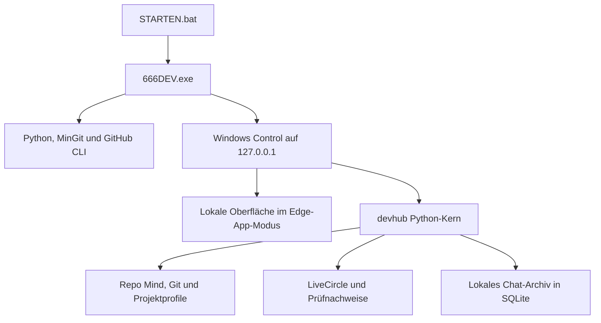

# 666DEV Windows Control

## Start und Komponenten

Das portable Windows-x64-Paket verwendet den 666DEV-Checkout seiner
Build-Revision. Ein Doppelklick auf `STARTEN.bat` öffnet das Menü für Start,
Prüfung und Diagnose. `666DEV.exe` ist der direkte Einstieg. Der Launcher
stellt die gebündelten Werkzeuge über den Suchpfad bereit und startet die
vorhandene Desktop-Anwendung im Paket-Checkout.



Im Normalbetrieb öffnet die vorhandene Windows-Logik den Edge-App-Modus.
Falls Edge fehlt, öffnet sie die lokale Oberfläche im Standardbrowser.
`STARTEN.bat --headless` startet den lokalen Server auf einem freien Port und
gibt die URL in der Konsole aus. `Strg+C` beendet den Server.

| Schicht | Pfad im Checkout | Aufgabe |
| --- | --- | --- |
| Desktop-Host | `windows-app/app.py` und `windows-app/ui/` | Lokale HTTP-Schnittstelle, App-Fenster und Bedienung. |
| Hub | `src/devhub/cli.py`, `core.py` und `registry/projects.json` | Befehle, Projektwahl, Git-Basis, erlaubte Schreibpfade und Abnahme. |
| Repo Mind | `src/devhub/repo_mind.py` und `repo_mind_context.py` | Quellkontext, Git-basierte Repo-Prüfung und ausdrücklich freigegebene Review-Aktionen. |
| LiveCircle | `src/devhub/livecircle.py` und `recovery.py` | Projektstand und Handoffs gegen die belegte Revision prüfen. |
| Chat-Archiv | `src/devhub/chat_archive.py` | Lokale Exportdateien transaktional einlesen, Text durchsuchen und Markdown exportieren. |
| Build | `windows-app/build_portable.py`, `windows-app/portable/` | Windows-x64-Starter, Laufzeiten, sauberer Checkout und Abnahme des entpackten ZIPs. |

## Daten und Betriebsgrenzen

- Windows Control bindet standardmäßig an `127.0.0.1:8767`. Ändernde
  HTTP-Anfragen prüfen Host, Origin und das Token der lokalen Sitzung.
  Das Edge-Fenster dient als Oberfläche für diese lokale Sitzung.
- Unter **Repo Mind → Chat-Archiv** wählst du eine lokale ChatGPT- oder
  AI-Exporter-Datei. Import, Suche und Markdown-Export verwenden
  `checkout/.work/chat-archive/archive.sqlite3`. Die SQLite-Datei enthält
  Klartext und kann bei geschlossener Anwendung separat gesichert werden.
- Windows-Einstellungen und Starter-Logs liegen in
  `checkout/.work/windows-app/`. Für Diagnose führt die Batch die vorhandene
  Startprüfung aus und schreibt ein Protokoll unter `logs/`. Die Prüfung
  meldet unter anderem die Git-Revision und fehlende App-Dateien.
- Arbeitspointer, Current und Checkpoints registrierter Projekte liegen
  unter `checkout/projects/<projekt>/state/`. Für ihre Wiederaufnahme gelten
  Projekt-ID, Quellrevision und der LiveCircle-Vertrag. Ein Chat-Export ist
  Referenzmaterial.
- Die lokale Arbeit mit dem enthaltenen Checkout funktioniert offline.
  GitHub-Aktionen mit Schreibzugriff verwenden eine eigene GitHub-CLI-Anmeldung
  und die vorhandene Freigabe in Repo Mind.

## Build und Wechsel auf eine neue Ausgabe

`BUILD-INFO.json` im entpackten Paket hält den exakten Git-Commit, die
Zielarchitektur, die Go-Toolchain und die Herkunft samt SHA-256 der
Laufzeitarchive fest. Der Build benötigt Git, Python ab 3.11 und Go.
Er verpackt ausschließlich den Commit am Git HEAD und prüft die gebündelten
Laufzeitarchive vor dem Entpacken.

```powershell
python windows-app/build_portable.py --output .work/666DEV-Windows-x64.zip
```

Der Windows-Workflow startet die Batch aus einem anderen Arbeitsverzeichnis
und einem Paketpfad mit Leerzeichen. Geprüft werden Startdiagnose, Rückgabecode
bei Fehlern, Protokolldatei, Projektstatus und der vollständige Weg vom
Chat-Import über die Suche bis zum Markdown-Export.

Für einen Wechsel 666DEV zuerst beenden und das neue ZIP in einen eigenen
Ordner entpacken. Den bisherigen Ordner als Rückkehrpunkt behalten.
Die lokale Chat-Datenbank und die Windows-Einstellungen können gezielt aus
`.work` übernommen werden. Bei Projektständen die zugehörige Quellrevision
und den LiveCircle-Handoff zusammen sichern.
